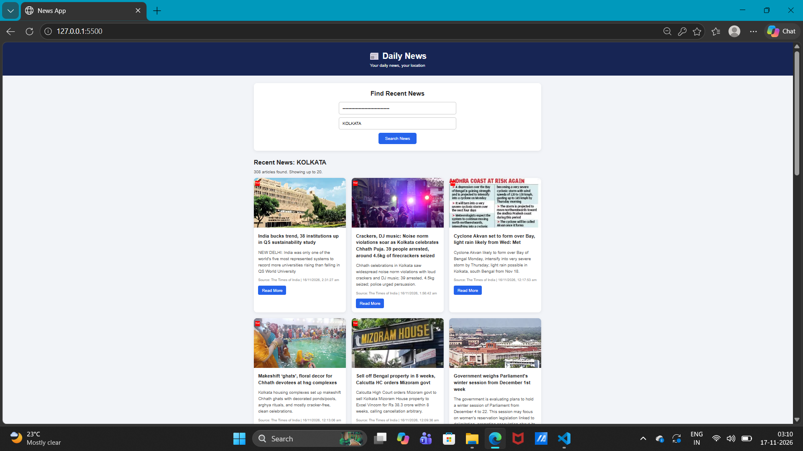
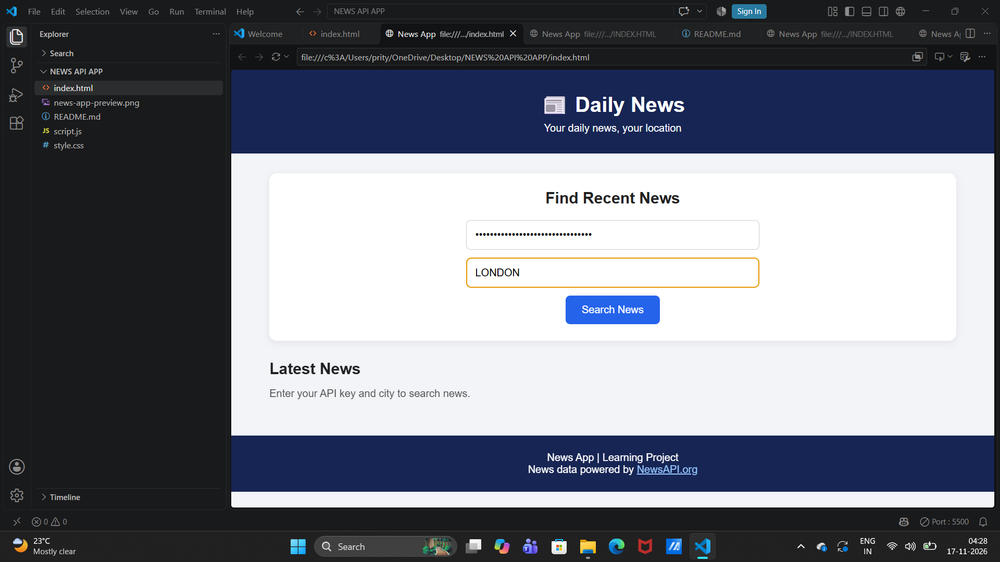

# 📰 Daily News App

A responsive News App built using **HTML, CSS, JavaScript, and NewsAPI.org**.

The application allows users to search for recent news articles by entering a city name. It displays news headlines, descriptions, source information, publication dates, and article links.

## 🚀 Live Demo

[Open Daily News App](https://vishal301206-dot.github.io/NEWS-APP/)

## 📸 Project Preview



## ✨ Features

- Search news by city name
- Fetch news articles using NewsAPI.org
- Display article headlines and descriptions
- Show news images and sources
- Display publication dates
- Read More links to original articles
- Responsive user interface
- Loading and error messages

## 📷 Screenshots

### Homepage


### News Search Results


## 🛠️ Technologies Used

- HTML5
- CSS3
- JavaScript
- NewsAPI.org
- GitHub Pages

## 📂 Project Structure

```text
NEWS-APP/
│
├── index.html
├── style.css
├── script.js
├── news-app-preview.png
└── README.md
```

## 💻 Run Locally

1. Clone or download this repository.
2. Open the project folder in VS Code.
3. Run `index.html` using Live Server.
4. Enter your NewsAPI key and a city name.
5. Click **Search News**.

## 🔐 API Key & Security

This project uses NewsAPI.org to retrieve news articles.

For local testing, enter your own API key in the application. Never upload API keys or secrets to a public repository.

The public GitHub Pages version is a frontend demonstration. Live API requests may be restricted by the NewsAPI plan and browser security rules. A secure backend is needed for a production deployment.

## 🎯 Learning Outcomes

Through this project, I practised:

- Working with REST APIs
- Using JavaScript Fetch API and async/await
- Handling JSON responses
- DOM manipulation
- Error handling
- Creating responsive web pages
- Hosting a project using GitHub Pages

## 👨‍💻 Author

**Vishal Kumar**

GitHub: [vishal301206-dot](https://github.com/vishal301206-dot)

---

⭐ If you find this project interesting, feel free to explore the repository!
